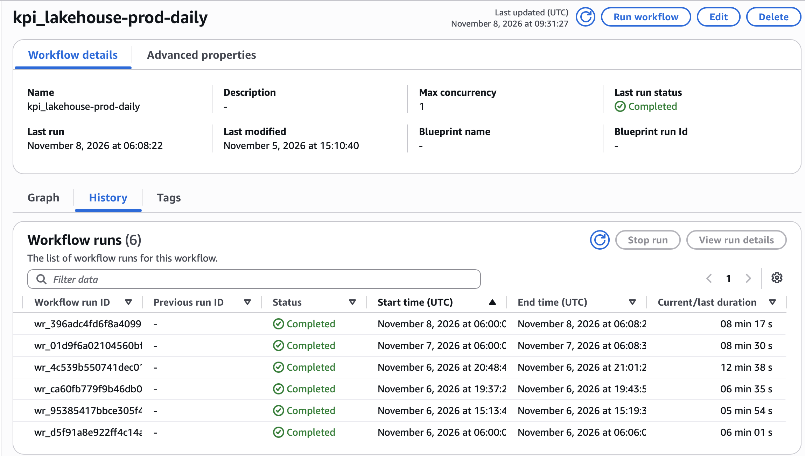
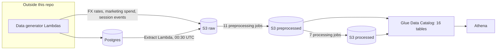

# kpi_lakehouse

[](https://github.com/anotherjdw/kpi_lakehouse/actions/workflows/ci.yml)
[](https://github.com/anotherjdw/kpi_lakehouse/deployments)

kpi_lakehouse is an AWS lakehouse for a simulated online shop. The lakehouse extracts data from a Postgres
database into a raw layer, 11 Glue jobs clean the data, and 7 Glue jobs build the analytics tables:
daily sales, daily marketing channel performance, and monthly return rates.

* **Built in about 24 hours** of work, from 22 October to 6 November.
* **Running daily** in AWS since 6 November 2026.
* **18 Glue jobs and 16 Glue Data Catalog tables**, with a description for every table and column.
* **260 tests**, run in CI before every deployment.
* **All infrastructure in Terraform**, deployed by GitHub Actions after a reviewer's approval.

The pipeline was built using the `engineering-automation` tool, a CLI I created. AI is making pipeline code fast
to write, but the documentation lags behind and the code becomes a black box; when every engineer writes their own
prompts, the results vary from person to person. With `engineering-automation`, I write the job specifications and
data contracts first, and they drive the code: templates produce everything that can be prepared in advance, and the
AI model writes the transformation logic and expected test data, which are checked before they're written. See [How
it was built](#how-it-was-built).



*Glue Workflow run history: daily runs since 6 November 2026*

## What kpi_lakehouse produces

kpi_lakehouse reports on an online shop selling perfume products, with prices in euros. Two data generator Lambda
functions, outside of this project, write orders, returns, customers, products and categories to a Postgres database,
and exchange rates, marketing costs and sessions directly to S3.

This pipeline reports three KPI tables:

| Table | Granularity | Measures |
| --- | --- | --- |
| kpi_daily_sales | order date | Orders, units, cancelled orders and the cancellation rate; net sales, net revenue, gross merchandise value, gross margin and margin %, and average order value. |
| kpi_channel_performance | date and marketing channel | Sessions, converted sessions and the conversion rate; ad spend, attributed net revenue and return on ad spend (ROAS). |
| kpi_return_rate | month and level-1 category | Units sold and returned, refund amounts excluding tax, the return rate, and whether the month's return rates are final. |

All three KPI tables are built from the two fact tables:
* `fact_order_line`: one row per item sold, with its cost, margin, any return and its attributed marketing channel.
* `fact_session`: one row per visit to the shop, with its landing channel and whether it converted into an order.

Customer and product data change over time, so they are kept as versioned dimensions, and each order and session is
joined to the version valid on its date, not the date of the export.

## How it was built
`engineering-automation` is a documentation-driven CLI tool I created. It turns job specifications and
data contracts into a tested ETL job, ready to deploy, in under an hour. Each job is built in four steps:

1. **Write the specification and contracts (me).** The tool creates empty YAML files for the job specification and
   its data contract, and I fill them in. I also set up the input test data.
2. **Render the job (templates, no AI).** Templates generate everything around the transformations: reading and
   writing the data, the contract checks, the run record, the schemas, all tests and the Terraform.
3. **Draft the expected test data (Claude API).** The model drafts each transformation's expected data from its
   description in the job specification and the input test data, without seeing the code. I review every row.
4. **Generate the transformation code (Claude API).** The code must parse, match the names set in the specification,
   use only allowed imports and names, and pass ruff's lint and format checks before it is written. A rejected
   answer is saved for inspection, and the tool moves on to the next transformation.

Outside of the tool, I built the Glue Workflow and made the fixes after deployment. The extract Lambda was written
by AI. I'll review and redesign it to integrate it as templated code in the tool. Changes to an existing job are
made by hand for now, and AI maintenance is planned (see [Limitations and Next Steps](#limitations-and-next-steps)).

### Timeline
| Date | Work | Hours |
| --- | --- | --- |
| 22 October | Project scaffold | < 0.5 |
| 25-27 October | 10 preprocessing jobs | 5 |
| 28-29 October | 3 dimension tables, `fact_order_line`, `fact_session` | 4 |
| 30 October | `kpi_daily_sales` and `kpi_channel_performance` | 3 |
| 31 October | `kpi_return_rate` | 1 |
| 2 November | Extract Lambda and its scheduler in Terraform | 1 |
| 5 November | Lambda code and build moved into the repo, created Glue Workflow by hand | 5 |
| 6 November | Fixes after deployment | 5 |

The 18 jobs took 13 hours, about 45 minutes per job, 3/4 of it spent on the job specifications and contracts.
Generating the transformation code and expected data takes about 15-30 seconds per job, depending on the number of
transformations.

`engineering-automation` is a private project I use for my freelance and independent work. I am happy to walk
through it upon request.


## Engineering Decisions
`engineering-automation` builds three data engineering principles into every job from the start: data is checked
against a contract, every run is recorded, and every transformation is tested. The aim is to automate the
repetitive work, so that non-technical stakeholders can create and develop a pipeline that data engineers can also
trust.

### Documentation drives development
Every dataset has a data contract stating its columns, data types, nullability, unique keys and descriptions. The
contracts:
1. **Drive the code**. Each job's schemas and data checks are generated from data contracts.
2. **Are checked on every write**: The exact columns and their types, null values in non-nullable columns, and
   duplicate unique keys are checked before data is written to S3. If a check fails, the job stops, and no bad data
   reaches the lakehouse.
3. **Are the documentation people see**: The descriptions become table and column comments in the Glue Data
   Catalog, for analysts and non-technical stakeholders.

For an example, see [`kpi_return_rate`](src/kpi_lakehouse/contracts/kpi_return_rate_data_contract.yaml) and the
check in [`utils/dataframes.py`](src/kpi_lakehouse/utils/dataframes.py).

### Every run is on the record
Each job run prints one `RUN_RECORD` ([`runtime/job_settings.py`](src/kpi_lakehouse/runtime/job_settings.py)): its
status, the step that failed (read, transform or write), each step's duration, the dates processed and the Glue run
ID. Errors are re-raised, so Glue marks the run as failed. For now I check failed runs in the console, alerting is
planned (see [Limitations and Next Steps](#limitations-and-next-steps)).

<details>
<summary><b>Example run records: a failed and a successful run of <code>orders</code></b></summary>


```json
{
  "status": "FAILED",
  "glue_job_name": "kpi_lakehouse-prod-orders",
  "glue_run_id": "jr_2aec0c3598168e63428c932dd80f28ed510e19f9b823b1e85412f97f4b7d1daf",
  "job_name": "orders",
  "environment": "prod",
  "phase": "write",
  "duration_seconds": 21.458,
  "error_message": "Data validation failed: nulls in non-nullable columns {'rate_date': 317, 'base_currency': 317, 'quote_currency': 317, 'rate': 317, 'shipping_fee_eur': 317}",
  "error_type": "ValueError",
  "finished_at": "2026-11-06T19:41:12+00:00",
  "metrics": {},
  "phase_durations": {
    "read": 15.011,
    "transform": 2.261,
    "write": 4.186
  },
  "processing_dates": {
    "fx_rates": ["2026-10-23", "...", "2026-11-05"],
    "orders": ["2026-10-23", "...", "2026-11-05"]
  },
  "started_at": "2026-11-06T19:40:50+00:00",
  "traceback": "Traceback (most recent call last):\n  File \".../runtime/job_settings.py\", line 111, in job_run\n    yield record\n  File \".../orders.py\", line 37, in run\n    job.write(output, args.OUTPUT_PATH, args.OUTPUT_TABLE)\n  File \".../jobs/orders/orders_transformations.py\", line 216, in write\n    validate_pyspark_dataframe(\n  File \".../utils/dataframes.py\", line 85, in validate_pyspark_dataframe\n    raise ValueError(\nValueError: Data validation failed: nulls in non-nullable columns {...}\n"
}
```
*Failed: `fx_rates` covered only the same 14 days as `orders`, so orders placed earlier had no exchange rate.*

```json
{
  "status": "SUCCEEDED",
  "glue_job_name": "kpi_lakehouse-prod-orders",
  "glue_run_id": "jr_7b13fd075dd0b5be765b8d9a9cc936da21daf2c0f87cf7053b05c8e82383b8d6",
  "job_name": "orders",
  "environment": "prod",
  "phase": null,
  "duration_seconds": 54.423,
  "error_message": null,
  "error_type": null,
  "finished_at": "2026-11-08T06:04:16+00:00",
  "metrics": {},
  "phase_durations": {
    "read": 29.947,
    "transform": 2.493,
    "write": 21.983
  },
  "processing_dates": {
    "fx_rates": ["2026-09-09", "...", "2026-11-07"],
    "orders": ["2026-10-25", "...", "2026-11-07"]
  },
  "started_at": "2026-11-08T06:03:22+00:00",
  "traceback": null
}
```
*Successful, after the fix: `fx_rates` covers 60 days, so every order in the 14-day window has a rate.*

</details>

### Debugging after deployment
Two issues arose after deployment that required debugging:
1. **`orders` failed its contract check**: `fx_rates` read the same 14 days as `orders` so orders updated in that
   window put placed earlier had no exchange rate, leaving 317 nulls in non-nullable columns (see failed run above).
   The check stopped the write, so no bad data was written. Backfilling `fx_rates` and extending its lookback to 60
   days fixed it.
2. **`fx_rates` ran past the last published rate**: Its date filter let the weekend and holiday carry-forward run to
   the last date in the `dates` source, 2026-12-31. Three filters replaced it: drop dates on or after the first
   weekday after the published rate, drop dates on which no currency other than EUR has a rate, and drop any other
   remaining rows without a rate.

### Nothing deploys untested
`kpi_lakehouse` contains 260 tests in 63 files: 239 generated by `engineering-automation` from the job
specifications and contracts, and 21 for the extract Lambda. They run locally with `make check` and in CI on every
push, before `terraform plan` and `terraform apply`:
* Unit tests for every transformation, comparing its output with the expected test data I reviewed.
* Integration tests for each job's read, transform and write steps.
* End-to-end tests that run the whole job and compare its output with the expected data.

Comparing against reviewed expected data checks that the data is *correct*, not only that the job runs. These tests are
the only thing that executes the generated code before it reaches the lakehouse. A development environment, where
the  deployed jobs must run successfully before production is updated, is planned (see [Limitations and Next Steps](#limitations-and-next-steps)).

### Pipeline specific decisions

* **Customer and product history**: the dimensions keep every version of a customer and product, and the order and
  session data link to the version valid on its date.
* **FX rates**: amounts are converted at the rate for the order date, carrying forward weekends and holidays.
* **Return rates**: a month's return rate is marked `is_final` only once the data is more than 45 days past the
  month's end, which is the return window.

## Architecture



### Extraction

The `shop-sim-extract` Lambda runs at 00:30 UTC, started by an EventBridge Scheduler. It connects to the shop's
Postgres database inside the Virtual Private Cloud (VPC) with IAM database authentication over TLS, so no database
password is stored anywhere. Each table is extracted according to how the data changes:
* orders and returns: rows changed since the last extract run.
* order items: new rows only.
* customers and products: full daily snapshot.
* categories: full, unpartitioned replacement.

The watermark (bookmark) moves only after the files are written to S3. `fx_rates`, `session_events`, and
`marketing_spend` are written directly to S3, standing in for a REST API; a Lambda that pulls from it is planned.
`dates` is a static JSON file covering 2024 to 2026.

### Storage and layers

Each layer has its own S3 bucket, in the medallion style, and a fourth bucket holds job and Lambda code. All
buckets are versioned, encrypted and closed to public access.

* **Raw (bronze)**: the data stays exactly as the sources write it, as JSON files (session_events is written as
  parquet), partitioned by date except `categories` and `dates`.
* **Preprocessed (silver)**: cleaned tables, ready for the KPIs. Customers and products are versioned, and orders
  and marketing spending are converted into Euros.
* **Processed (gold)**: the processing ETL jobs build the dimension, fact and KPI tables. See
  [What kpi_lakehouse produces](#what-kpi_lakehouse-produces).

### Orchestration

One AWS Glue Workflow starts daily at 06:00 UTC, 5.5 hours after the extract. It starts the five jobs that read a
raw data source and don't depend on an upstream job. Every other job starts once all upstream jobs have succeeded. If a
job fails, everything downstream stops, so no KPI is calculated from incomplete data.

### Catalog and Querying

16 tables are published in the Glue Data Catalog, in one database each for the preprocessed and processed
layers, and can be queried with Athena. `categories` and `dim_dates` aren't published, because the tool needs a
partition keys to register each run's partitions (see [Limitations and Next Steps](#limitations-and-next-steps)).

### Infrastructure and Deployment

All AWS resources are defined in Terraform, so the whole setup can be rebuilt from the repo. A separate
bootstrap Terraform root creates the IAM roles that GitHub Actions assumes through OpenID Connect (OIDC), so no AWS
keys are stored in GitHub. The CI/CD workflow:
* runs linting, type checks, all tests and Terraform validation on every push and pull request,
* runs a read-only `terraform plan`, posted as a comment on pull requests,
* on a push to `main`, runs `terraform apply` once a reviewer approves it in the `prod` environment,
* then uploads the shared Glue code and the job scripts to the scripts bucket. `terraform apply` uploads the
  Lambda's code.

To set up the project locally and deploy it, see [docs/deployment.md](docs/deployment.md).

### Repository layout
<details>
<summary><b>Overview of the repository structure</b></summary>

```
.github/workflows/
└── ci.yml              # CI/CD: quality gates, Terraform validate/plan/apply, upload of job code
docs/images/            # screenshots used in this README
scripts/
└── build_lambda.sh     # builds the extract Lambda's zip (run by CI before terraform plan)
Makefile                # install, test, check and other local commands
src/kpi_lakehouse/
├── contracts/          # data contracts — one YAML per dataset; generation-time input, never shipped
├── jobs/               # one subdirectory per ETL job: job spec, Glue entry point, transformations
├── lambdas/            # the extract Lambda: Postgres → raw-layer files in S3
│   ├── common/         # database connection, contracts and S3 writing shared by Lambdas
│   └── shop_sim_extract/  # the Lambda handler and its table definitions
├── runtime/            # the run record every job emits
└── utils/              # shared runtime: read, validate and write DataFrames, date windows,
    │                   # register a table's partitions
    └── schema/         # one StructType per data contract in use (tool-owned)
infra/terraform/        # all AWS resources for this data product
├── modules/            # s3, iam, glue, catalog and lambda
└── bootstrap/          # CI/CD OIDC provider + plan/deploy/scripts roles (applied once)
tests/
├── conftest.py         # local Spark session and temporary folders for every test
├── helpers.py          # shared helpers: assertions, fixture rows and fixture files
├── fixtures/           # input and expected rows, one folder per job
│   └── lambdas/        # the shop's Postgres schema for the Lambda tests
├── unit/               # one test per transformation; utils/ tests the shared runtime
│   └── lambdas/        # unit tests of the extract Lambda
├── integration/        # read, transform and write against local files
│   └── lambdas/        # the extract Lambda against a throwaway local Postgres
└── end_to_end/         # a whole job run
```

</details>

## Limitations and next steps
This project and the `engineering-automation` tool are works in progress. Please see below for a list of limitations
and roadmap items for further development:

* **One environment → dev and prod environments**: Everything runs in `prod`. **Planned**: A `dev` environment where
  the deployed jobs must run successfully before `prod` is updated, with the deploy recording the `dev` run that
  approved it.
* **No alerting yet → alerting based on run records**: Failed jobs are only visible in the console. **Planned**:
  Alerting from the `RUN_RECORD` and CloudWatch, sent through Amazon Simple Notification Service (SNS).
* **Glue triggers → Orchestration that waits for each job**: A job with several upstream jobs only starts if they
  start at the same time, otherwise its conditional glue trigger never fires. **Status**: Airflow is being looked
  into as an alternative. The trade-off is cost: an Airflow environment on AWS is billed around the clock.
* **Limited data checks → data governance in the contracts**: The contracts check only data types,
  column sets, nullability and unique keys. **Planned**: Allowed values (enums), value ranges, and GDPR/PII checks,
  as well as freshness and volume checks against agreed service levels.
* **AI-written extract Lambda → extraction in `engineering-automation`**:
  `shop-sim-extract` was written by AI to extract fake data from a Postgres database. **Planned**: A revised version,
  as a command of the tool, that extracts the data and creates its source data contract.
* **Two outputs have no table → tables for unpartitioned data**: `categories` and `dim_dates` have no tables,
  because the tool needs a partition key to register new partitions. **Planned**: Tables for unpartitioned data.
* **Changing an existing job is manual → AI maintenance in a deterministic workflow**: The tool only fills in code
  and expected test data that are still empty, so any later change is made by hand. **Planned**: When a job
  specification or data contract changes, AI agents working inside a deterministic workflow update the job's code,
  docstrings, expected test data and tests, and those of its downstream jobs. The workflow checks every change
  against the specifications and contracts, so the pipeline upholds data engineering best practices as the code
  develops.

## Contact
For further questions and information, please email me (Joshua Hooker) at jdh686@outlook.com.
